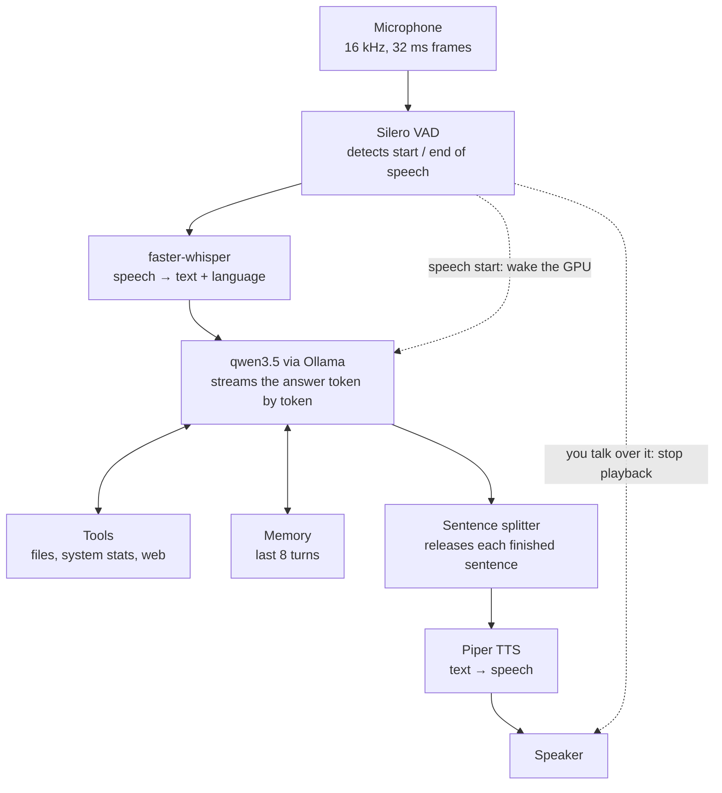
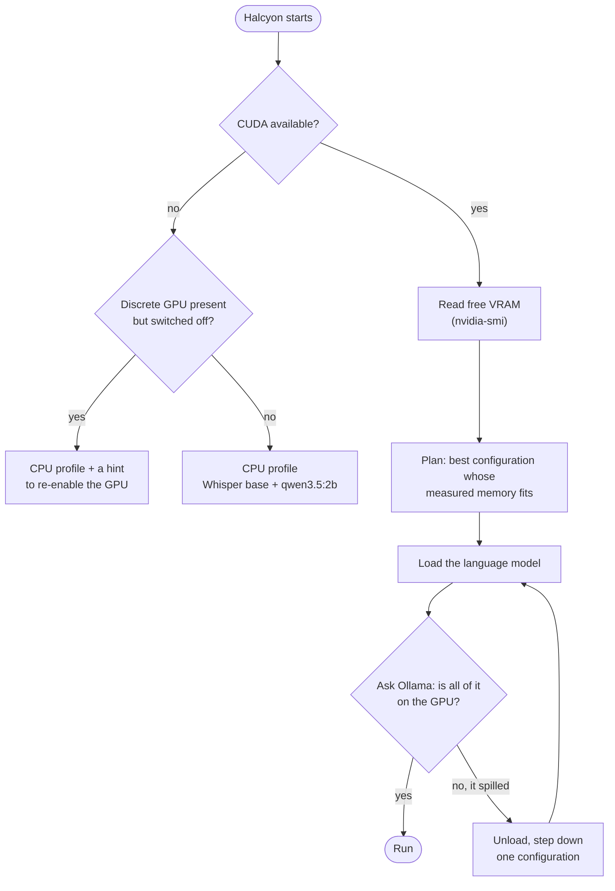

# Halcyon

[](https://github.com/SuleymanKilincc/Halcyon/actions/workflows/tests.yml)

**A fully local, voice-driven AI assistant.** You speak, it answers out loud — in Turkish or English — and nothing leaves your machine.

Halcyon listens continuously, notices when you stop talking, transcribes your speech, thinks with a local language model, can call tools on your computer, and starts speaking its answer before it has finished generating it. You can interrupt it mid-sentence. It detects whether your laptop's discrete GPU is available and picks a matching set of models on its own.

**Why "Halcyon"?** It is pronounced *HAL-see-un*. In Greek myth the halcyon is a bird that calms the sea, and "halcyon days" means a calm, peaceful time, which is the manner the assistant aims for. The project was called Jarvis until October 2026.

## Highlights

- **100% local speech pipeline** — speech recognition, language model and speech synthesis all run on-device. No cloud APIs, works offline (web search excepted).
- **Streaming responses** — the first sentence is spoken as soon as it is generated, instead of waiting for the full answer.
- **Barge-in** — talk over Halcyon and it stops speaking immediately.
- **Turkish and English** — the language is detected per utterance, and each sentence of a reply is read by the voice of its own language.
- **Does not answer noise** — room noise, breathing and keyboard clicks no longer come out as *"Thank you."*, and speech too garbled to understand is dropped instead of being acted on. Measured, see below.
- **Tool calling** — lists directories, reads files, reports system temperatures, searches the web. Verified against real output, not just prompted to claim it.
- **Conversation memory** — follow-up questions like *"how many were there?"* resolve against earlier turns.
- **Knows its limits** — told exactly which actions are switched off and why, it declines them plainly and offers what it can do; it answers from tool results instead of filling gaps from memory. Measured before and after on 15 requests.
- **Adapts to the GPU** — picks the largest models that fit the card's free memory, checks after loading that nothing spilled onto the CPU, and steps down on its own if it did. Lightweight CPU models when no GPU is available.

## Measured performance

Measured on the development machine (AMD Ryzen 7 7735HS, 32 GB RAM, RTX 4060 Laptop GPU with 8 GB VRAM, Windows 11). *First audio* is the time from the moment you stop speaking until you hear the first sound back — the number that decides whether it feels like a conversation.

| | Battery profile (CPU) | Performance profile (GPU) |
|---|---|---|
| Speech recognition | ~500 ms | **234–377 ms** |
| Language model, first token | ~1000 ms | **114–134 ms** |
| **First audio** | best 1.8 s | **1.1–1.6 s** |
| Turkish recognition accuracy | weak (small model) | good |

Reproduce with `python -m bench.latency --llm` — the benchmark synthesises speech and feeds it through the real pipeline, so no microphone is needed. Recognition quality (word error rate in clean, far-field and noisy conditions, and hallucinations on non-speech) is measured with `python -m bench.stt_eval`; results are in [`docs/VOICE.md`](docs/VOICE.md#speech-recognition-quality).

## How it works



1. **Voice activity detection** decides when you started and stopped talking. No push-to-talk button: 480 ms of silence ends a turn.
2. **Speech-to-text** transcribes the utterance and detects its language.
3. **The language model** answers, calling tools when needed, with the recent conversation as context.
4. **The sentence splitter** hands each completed sentence to the speech synthesiser while the rest of the answer is still being generated.
5. **Text-to-speech** plays it back. The microphone keeps listening, so you can interrupt.

### Adapting to the GPU

Halcyon runs two models on the same card — Whisper for speech and a language model through Ollama — and the right pair depends on how much memory is free. A fixed rule cannot serve both a 4 GB and a 32 GB card: the first overflows, the second sits mostly idle. So the choice is made in two layers:



1. **Plan.** Every component's memory use was measured (`python -m bench.vram`), and the planner picks the best configuration that fits the card's *free* memory, from a ladder ordered by preference: a larger language model first, then the large Whisper (the small ones are poor at Turkish), then a longer context.
2. **Verify.** Ollama keeps more headroom than the sizes it reports, and how much is not documented — so a plan can fit on paper and still spill. After loading, Halcyon asks Ollama how much of the model actually landed on the GPU, and steps down if any of it spilled. This is what makes it correct on cards that were never tested: forced onto a configuration known to spill on the 8 GB card, it detected *"only 84% on the GPU"* and stepped down on its own.

What the planner chooses for typical cards (free memory after the desktop's share):

| Card | Language model | Context | Speech model |
|---|---|---|---|
| RTX 3050, 4 GB | qwen3.5:2b | 8k | Whisper small |
| RTX 3060 Laptop, 6 GB | qwen3.5:4b | 8k | Whisper large-v3-turbo |
| **RTX 4060 Laptop, 8 GB** | **qwen3.5:9b** | **8k** | **Whisper large-v3-turbo** |
| RTX 3060 / 4080, 12–16 GB | qwen3.5:9b | 32k | Whisper large-v3-turbo |
| RTX 4090 / 5090, 24–32 GB | qwen3.5:27b | 32k | Whisper large-v3-turbo |

Only the 8 GB configuration (bold) has been run end to end. The others are the planner's choices from measured component sizes; the 27B figures are estimates because that model has not been downloaded on the development machine, and the verification step corrects any of them on real hardware. If a better model would fit but is not installed, Halcyon uses the best installed one and says which to pull.

On laptops the discrete GPU can also be powered off entirely (for example in an "Eco" GPU mode). Python's usual hardware queries then report *no GPU at all*. Halcyon asks Windows directly (`Get-PnpDevice`), which tells *"installed but disconnected"* apart from *"absent"*, so it explains why it is on the CPU instead of silently degrading.

## Engineering notes

A few problems that shaped the design. Details and raw measurements are in [`docs/VOICE.md`](docs/VOICE.md).

- **A bigger context window was slower.** At a 16k-token context the 9B model no longer fit in 8 GB of VRAM; Ollama placed 16% of it on the CPU, which dragged every token down to CPU speed. At 8k it runs 100% on the GPU. The setting that fits beats the setting that is nominally larger.
- **The benchmark said 140 ms, real use said 2.2 s.** Both were right. The benchmark sent requests back to back; a person pauses to speak and listen, and in that gap the laptop GPU drops into a low-power state that costs ~2 s to leave. The fix moves the wake-up to the moment you *start* speaking, so it overlaps with time that is already being spent.
- **Making the speech benchmark reproducible took three fixes.** Two runs of the same settings disagreed by over 10 points of error rate. The causes: Piper synthesises speech with deliberate randomness, so the test audio itself changed between runs; Whisper retries noisy audio with random sampling; and the background noise depended on the order clips were generated in. With all three pinned, two runs now produce identical tables — and one earlier conclusion reversed: re-decoding misdetected audio in Turkish, which had looked neutral, actually made it worse.
- **GPU speech recognition worked by accident.** faster-whisper finds NVIDIA's cuBLAS library only if something has already loaded it, and PyTorch happened to be imported first. Measuring Whisper's memory in isolation crashed with *"cublas64_12.dll is not found"*. The dependency is now explicit instead of depending on import order.
- **The measuring tool was measuring itself.** An early benchmark reported a near-identical ~3.7 s on every input. It was abandoning each response stream after the first sentence while the server kept generating, so every measurement queued behind the previous one. Suspiciously uniform numbers turned out to be the clue.

## Tech stack

| Layer | Technology |
|---|---|
| Language model | [Ollama](https://ollama.com) serving `qwen3.5` (2B / 4B / 9B) |
| Speech-to-text | [faster-whisper](https://github.com/SYSTRAN/faster-whisper) (CTranslate2) |
| Voice activity detection | [Silero VAD](https://github.com/snakers4/silero-vad) |
| Text-to-speech | [Piper](https://github.com/OHF-Voice/piper1-gpl) (ONNX Runtime) |
| Audio I/O | sounddevice (PortAudio) |
| GPU | PyTorch + CUDA 12.6 |
| Text agent | LangChain / LangGraph |
| Desktop UI | CustomTkinter |
| Storage | SQLite + SQLAlchemy |

Everything is Python 3.10.

## Usage

```bash
start_halcyon.bat                   # Windows launcher: checks Python, dependencies and Ollama, then runs the line below
python -m voice.cli --info          # show detected hardware and the chosen profile
python -m voice.cli                 # echo mode: test your microphone and speakers, no LLM
python -m voice.cli --llm           # talk to Halcyon
python -m voice.cli --llm --profile battery   # force the CPU profile
python -m voice.cli --llm --profile gpu-4b-8k # force a specific GPU configuration
python -m voice.cli --devices       # list audio devices, then pass --input / --output
```

Then just talk. There is no button.

## Tests

```bash
pip install -r requirements-test.txt
pytest
```

139 tests, about one second, and **no microphone, GPU or Ollama server required**: the hardware and the model server are replaced by fakes, so what gets tested is the project's own logic — sentence splitting, profile selection, the VRAM planner (including what it would choose for cards from 4 to 32 GB), the spill-and-step-down loop, the end-of-speech state machine, the tool-calling loop and conversation memory. They run on every push on Ubuntu and Windows via GitHub Actions.

The tests were checked by deliberately breaking the code: a one-character change to a threshold, and reverting a past bug fix, each turned exactly the right test red.

## Project structure

```
core/               hardware detection, VRAM planner, placement check, LLM client, voice tools
voice/              the speech pipeline: VAD, STT, TTS, audio I/O, turn state machine, CLI
bench/              latency, recognition quality, honesty about capabilities, memory per model
tests/              automated tests (pytest)
scripts/manual/     interactive checks that need a human (audio, windows, keyboard input)
tools.py            tool implementations (files, terminal, web, browser, archives, hardware)
agent.py            text-mode agent with the full tool set (LangGraph)
gui.py              desktop UI (still on the legacy voice pipeline)
database.py         SQLite session storage
docs/               VOICE.md (pipeline + measurements); archive/HISTORY.md (how the project got here)
```

## Limitations

Stated plainly, because they matter if you try it:

- **Developed and tested on Windows 11 only.**
- **Voice can only use read-only tools.** Writing files, deleting files and running shell commands are deliberately disabled by voice until a spoken confirmation layer exists. A misheard sentence should never reach a destructive tool.
- **No echo cancellation** — use headphones.
- **The desktop UI still uses the old pipeline**; the new one runs from the terminal.
- **The configuration is chosen once at startup.** Unplugging mid-session does not switch it.
- **Only the 8 GB GPU configuration has been run end to end**; the others are planned from measured sizes and verified at load time.
- **Mixed-language sentences** (Turkish with English terms inside one sentence) are transcribed as a single language.
- **Voice conversations are not persisted** yet; memory lasts for the session.
- A 9B local model is far weaker than frontier cloud models at multi-step reasoning, and can make things up.

## Roadmap

Ordered by what unlocks the most next. Nothing here is promised for a date; items move up when the one before them is measured and tested.

**Next**
- [ ] **Wake word** ("Hey Halcyon") so it only listens when addressed. Removes the accidental replies to side conversations and to speech-model phantoms. Needs a dedicated audio detector: the recogniser writes the name correctly only 10 times in 12, even with a hint ([measured](docs/VOICE.md#can-the-recogniser-write-the-name)).
- [ ] **Spoken confirmation layer + audit log.** Asks before it writes, deletes or runs anything, and logs what it did. Unlocks the file and shell tools by voice.
- [ ] **Faster tool turns.** Tool-using replies currently take 3-4.5 s to first audio; speaking a short acknowledgement while the tool runs hides most of it.
- [ ] **Easy setup.** A one-command installer that checks the GPU, picks the model size, and announces every download and its size before fetching it; later, a packaged Windows installer. The GPU planner and the download-size announcements already exist; the installer wrapped around them does not.

**Then**
- [ ] **Persistent memory** with semantic search, stored locally.
- [ ] **Barge-in:** interrupt it by speaking while it talks.
- [ ] **Speaker verification:** react to the owner's voice only.
- [ ] **More natural voice** (XTTS-v2).
- [ ] **Better Turkish on battery mode**, where the small recognition model is weakest.
- [ ] **Desktop UI** on the new voice pipeline.

**Later**
- [ ] **Screen understanding** — the model already supports vision.
- [ ] **Screen control** (click, type), behind the same confirmation layer.
- [ ] **Coding assistant:** read and edit a project, run its tests.
- [ ] **Plugin system** for adding tools.
- [ ] More languages.

## License

[MIT](LICENSE) © 2026 Süleyman Kılınç
