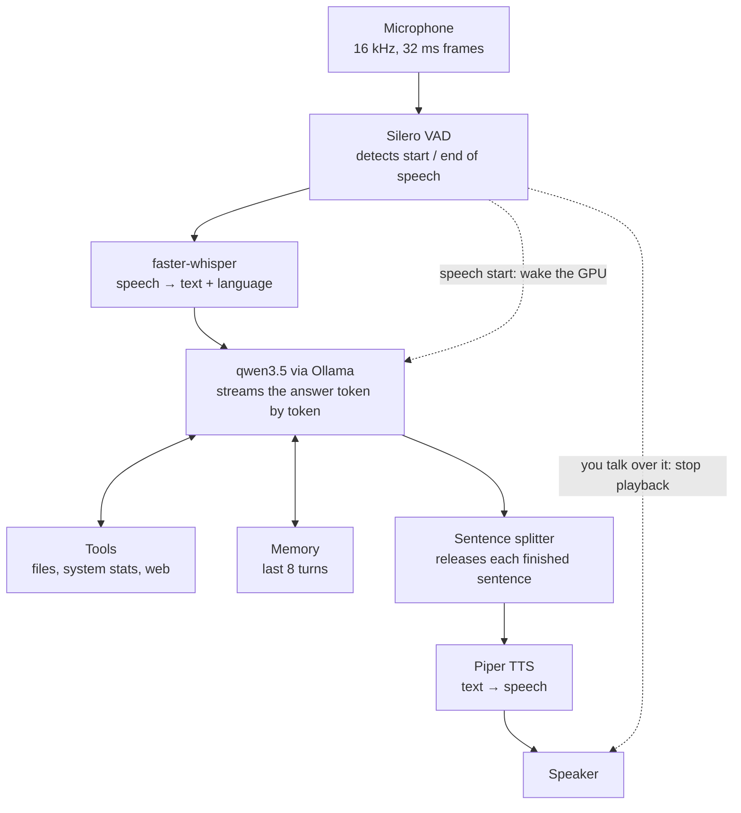
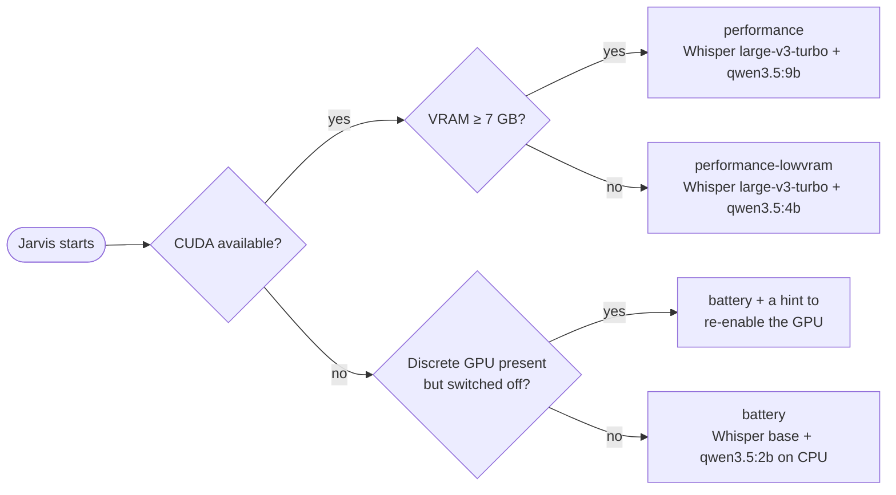

# Jarvis

[](https://github.com/SuleymanKilincc/Jarvis/actions/workflows/tests.yml)

**A fully local, voice-driven AI assistant.** You speak, it answers out loud — in Turkish or English — and nothing leaves your machine.

Jarvis listens continuously, notices when you stop talking, transcribes your speech, thinks with a local language model, can call tools on your computer, and starts speaking its answer before it has finished generating it. You can interrupt it mid-sentence. It detects whether your laptop's discrete GPU is available and picks a matching set of models on its own.

## Highlights

- **100% local speech pipeline** — speech recognition, language model and speech synthesis all run on-device. No cloud APIs, works offline (web search excepted).
- **Streaming responses** — the first sentence is spoken as soon as it is generated, instead of waiting for the full answer.
- **Barge-in** — talk over Jarvis and it stops speaking immediately.
- **Turkish and English** — the language is detected per utterance; the reply voice switches with it.
- **Tool calling** — lists directories, reads files, reports system temperatures, searches the web. Verified against real output, not just prompted to claim it.
- **Conversation memory** — follow-up questions like *"how many were there?"* resolve against earlier turns.
- **Hardware-aware profiles** — full-size models on the GPU when it is available, lightweight models on the CPU when the laptop runs on battery.

## Measured performance

Measured on the development machine (AMD Ryzen 7 7735HS, 32 GB RAM, RTX 4060 Laptop GPU with 8 GB VRAM, Windows 11). *First audio* is the time from the moment you stop speaking until you hear the first sound back — the number that decides whether it feels like a conversation.

| | Battery profile (CPU) | Performance profile (GPU) |
|---|---|---|
| Speech recognition | ~500 ms | **234–377 ms** |
| Language model, first token | ~1000 ms | **114–134 ms** |
| **First audio** | best 1.8 s | **1.1–1.6 s** |
| Turkish recognition accuracy | weak (small model) | good |

Reproduce with `python -m bench.latency --llm` — the benchmark synthesises speech and feeds it through the real pipeline, so no microphone is needed.

## How it works



1. **Voice activity detection** decides when you started and stopped talking. No push-to-talk button: 480 ms of silence ends a turn.
2. **Speech-to-text** transcribes the utterance and detects its language.
3. **The language model** answers, calling tools when needed, with the recent conversation as context.
4. **The sentence splitter** hands each completed sentence to the speech synthesiser while the rest of the answer is still being generated.
5. **Text-to-speech** plays it back. The microphone keeps listening, so you can interrupt.

### Hardware-aware profiles



On laptops the discrete GPU can be powered off entirely (for example in an "Eco" GPU mode). Python's usual hardware queries then report *no GPU at all*. Jarvis asks Windows directly (`Get-PnpDevice`), which can tell *"installed but disconnected"* apart from *"absent"* — so it explains why it is running slowly instead of silently degrading.

## Engineering notes

A few problems that shaped the design. Details and raw measurements are in [`docs/VOICE.md`](docs/VOICE.md).

- **A bigger context window was slower.** At a 16k-token context the 9B model no longer fit in 8 GB of VRAM; Ollama placed 16% of it on the CPU, which dragged every token down to CPU speed. At 8k it runs 100% on the GPU. The setting that fits beats the setting that is nominally larger.
- **The benchmark said 140 ms, real use said 2.2 s.** Both were right. The benchmark sent requests back to back; a person pauses to speak and listen, and in that gap the laptop GPU drops into a low-power state that costs ~2 s to leave. The fix moves the wake-up to the moment you *start* speaking, so it overlaps with time that is already being spent.
- **The measuring tool was measuring itself.** An early benchmark reported a near-identical ~3.7 s on every input. It was abandoning each response stream after the first sentence while the server kept generating, so every measurement queued behind the previous one. Suspiciously uniform numbers turned out to be the clue.

## Tech stack

| Layer | Technology |
|---|---|
| Language model | [Ollama](https://ollama.com) serving `qwen3.5` (2B / 4B / 9B) |
| Speech-to-text | [faster-whisper](https://github.com/SYSTRAN/faster-whisper) (CTranslate2) |
| Voice activity detection | [Silero VAD](https://github.com/snakers4/silero-vad) |
| Text-to-speech | [Piper](https://github.com/OHF-Voice/piper1-gpl) (ONNX Runtime) |
| Audio I/O | sounddevice (PortAudio) |
| GPU | PyTorch + CUDA 12.6 |
| Text agent | LangChain / LangGraph |
| Desktop UI | CustomTkinter |
| Storage | SQLite + SQLAlchemy |

Everything is Python 3.10.

## Getting started

### Requirements

- Windows 10 or 11 (the only platform tested so far)
- Python 3.10
- [Ollama](https://ollama.com/download)
- A microphone and **headphones** (there is no echo cancellation yet — through speakers, Jarvis hears itself)
- Optional: an NVIDIA GPU with 8 GB+ VRAM for the performance profile

### Install

```bash
git clone https://github.com/SuleymanKilincc/Jarvis.git
cd Jarvis
python -m venv .venv
.venv\Scripts\activate
pip install -r requirements.txt
```

For GPU acceleration, replace the default CPU-only PyTorch build:

```bash
pip install --index-url https://download.pytorch.org/whl/cu126 torch torchaudio
```

Pull the language models (the battery profile only needs the 2B one):

```bash
ollama pull qwen3.5:9b
ollama pull qwen3.5:2b
```

Speech models are downloaded automatically on first run (~1.7 GB for the GPU profile).

### Run

```bash
python -m voice.cli --info          # show detected hardware and the chosen profile
python -m voice.cli                 # echo mode: test your microphone and speakers, no LLM
python -m voice.cli --llm           # talk to Jarvis
python -m voice.cli --llm --profile battery   # force the CPU profile
python -m voice.cli --devices       # list audio devices, then pass --input / --output
```

Then just talk. There is no button.

## Tests

```bash
pip install -r requirements-test.txt
pytest
```

47 tests, about one second, and **no microphone, GPU or Ollama server required**: the hardware and the model server are replaced by fakes, so what gets tested is the project's own logic — sentence splitting, profile selection, the end-of-speech state machine, the tool-calling loop and conversation memory. They run on every push on Ubuntu and Windows via GitHub Actions.

The tests were checked by deliberately breaking the code: a one-character change to a threshold, and reverting a past bug fix, each turned exactly the right test red.

## Project structure

```
core/               hardware detection, runtime profiles, LLM client, voice tool list
voice/              the speech pipeline: VAD, STT, TTS, audio I/O, turn state machine, CLI
bench/latency.py    microphone-free latency benchmark
tests/              automated tests (pytest)
scripts/manual/     interactive checks that need a human (audio, windows, keyboard input)
tools.py            tool implementations (files, terminal, web, browser, archives, hardware)
agent.py            text-mode agent with the full tool set (LangGraph)
gui.py              desktop UI (still on the legacy voice pipeline)
database.py         SQLite session storage
docs/               VOICE.md (pipeline + measurements), system report (PDF)
```

## Limitations

Stated plainly, because they matter if you try it:

- **Voice can only use read-only tools.** Writing files, deleting files and running shell commands are deliberately disabled by voice until a spoken confirmation layer exists. A misheard sentence should never reach a destructive tool.
- **No echo cancellation** — use headphones.
- **The desktop UI still uses the old pipeline**; the new one runs from the terminal.
- **The profile is chosen once at startup.** Unplugging mid-session does not switch it.
- **Mixed-language sentences** (Turkish with English terms inside one sentence) are transcribed as a single language.
- **Voice conversations are not persisted** yet; memory lasts for the session.
- A 9B local model is far weaker than frontier cloud models at multi-step reasoning, and can make things up.

## Roadmap

- [ ] "Hey Jarvis" wake word
- [ ] Screen understanding — the model already supports vision
- [ ] Spoken confirmation layer + audit log, unlocking write/delete/shell tools by voice
- [ ] Persistent memory with semantic search
- [ ] Desktop UI on the new voice pipeline
- [ ] More natural voice (XTTS-v2)

## License

No license has been chosen yet. Until one is added, the default applies: all rights reserved.
